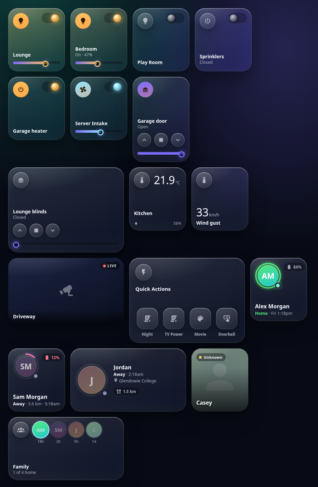
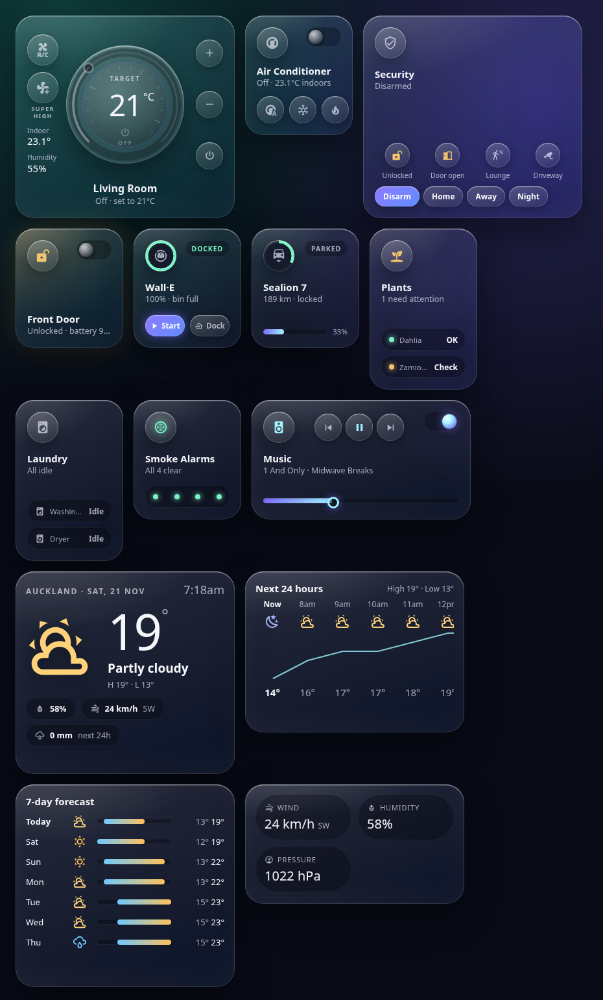
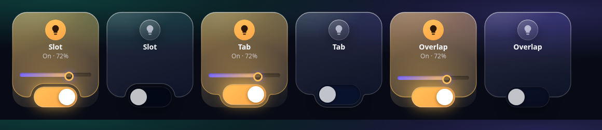

# Nocturne Card

[](https://my.home-assistant.io/redirect/hacs_repository/?owner=thekiwismarthome&repository=nocturne-card&category=plugin)
[](https://github.com/thekiwismarthome/nocturne-card/releases)

One Home Assistant card for every glass tile on a dashboard. You pick a **kind** (light, climate, media player, weather, person ...), pick an **entity of that kind**, and set the options. The entity picker only offers entities of the right domain, so a Light card only lists `light.*`.




It is designed for the Nocturne glass themes, but it falls back to your theme's colours, so it still looks fine on any other theme.

## Install

### With HACS (easiest)

1. Click the button at the top of this page, or in HACS open **⋮ → Custom repositories**, paste `https://github.com/thekiwismarthome/nocturne-card` and choose the type **Dashboard**.
2. Search for **Nocturne Card** and open it.
3. Press **Download**, then reload the page (**Ctrl+Shift+R**).

HACS adds the dashboard resource for you.

### By hand

1. Download `nocturne-card.js` from the [latest release](https://github.com/thekiwismarthome/nocturne-card/releases) into `config/www/`.
2. **Settings → Dashboards → ⋮ → Resources → Add resource**: URL `/local/nocturne-card.js`, type **JavaScript module**.
3. Hard-refresh the browser.

## Add a card

In the dashboard editor choose **Add card → Nocturne Card**. Pick the **Card kind** first, then the entity. Or use YAML:

```yaml
type: custom:nocturne-card
kind: light
entity: light.lounge
```

## Kinds

| Kind | Entities | What you get |
| --- | --- | --- |
| `light` | `light.*` | Tile with toggle and brightness slider. **Hold** opens a colour wheel popup. `variant: wheel` is a full colour wheel card (`layout: tall` or `wide`). |
| `switch` | `switch.*`, `input_boolean.*`, `valve.*`, `automation.*`, `script.*` | Toggle tile with an accent colour (`accent`, `water`, `air`, `warm`). |
| `fan` | `fan.*` | Icon spins while running, faster at higher speed. Smooth or 3-step speed slider. |
| `cover` | `cover.*` | Open, stop and close buttons, and a position slider if the device supports it. |
| `sensor` | `sensor.*`, `binary_sensor.*`, `input_number.*`, `number.*` | Big temperature with a secondary humidity bar, or a plain value tile. |
| `climate` | `climate.*` | The glass dial with mode and fan menus, +/- and power. `variant: compact` is the small tile. |
| `media` | `media_player.*` | Compact tile with transport and volume. `variant: full` shows a full music player if the separate `nocturne-music-card` resource is installed. See below. |
| `alarm` | `alarm_control_panel.*` | Glows green, amber or red with the alarm state. Optional chips for a lock, door, presence sensor and camera, and arm/disarm buttons. |
| `lock` | `lock.*` | Green when locked, amber when unlocked, with the battery in the label. |
| `vacuum` | `vacuum.*` | Battery ring, status pill, bin state, Start / Pause / Dock. |
| `vehicle` | `sensor.*` (the battery) | Battery ring and bar, range, locked and charging, from extra entities you choose. |
| `plants` | `plant.*` (several) | One row per plant, green when OK, amber when it needs attention. |
| `appliance` | `sensor.*` (several) | Time-remaining sensors for a washer, dryer, dishwasher and so on. |
| `safety` | `binary_sensor.*` (several) | One dot per smoke alarm. The whole card pulses red if any detects smoke. |
| `weather` | `weather.*` | Panels: `hero` (now and today), `hourly`, `daily`, `details`. |
| `camera` | `camera.*` | A still image with a Live badge; tap opens the stream. |
| `person` | `person.*` | One person: avatar with a presence or phone-battery ring, where they are, distance from home. Layouts `portrait`, `wide`, `photo`. |
| `family` | `person.*`, `device_tracker.*` (several) | A row of avatars and "2 of 4 home". |
| `actions` | `scene.*`, `script.*`, `button.*` (several) | A grid of round buttons. |

Multi-entity kinds take `entities:` (a list). Entries can be a plain entity id or an object with a name and icon:

```yaml
type: custom:nocturne-card
kind: appliance
name: Laundry
entities:
  - entity: sensor.washing_machine_time_remaining
    name: Washer
  - entity: sensor.dryer_time_remaining
    name: Dryer
```

### Options every card has

| Option | What it does |
| --- | --- |
| `name`, `icon` | Override the name and the `mdi:` icon. |
| `tap_action`, `hold_action` | Standard Home Assistant actions: `toggle`, `more-info`, `navigate`, `perform-action`, `url`, `none`. Lights also support `popup`. |
| `image` | A background image URL, for example `/local/robot.png`. |
| `image_opacity` | 0 to 100. |
| `image_fit` | `cover`, `contain` or `width` (uses `image_width`, in %). |
| `image_position` | `center`, `right-bottom`, `left-bottom`, `right-top`, `top`. |
| `image_blur` | Blur in px. |
| `image_fade` | Darken the image so the text stays readable. |

The visual editor lists every option for the chosen kind. The YAML view shows only the ones you changed.

### Person card

```yaml
type: custom:nocturne-card
kind: person
entity: person.alex
layout: portrait        # portrait | wide | photo
avatar: photo           # photo | initials | icon
ring: presence          # presence | battery | none
accent: auto            # a colour of their own, or accent | water | warm | good
color: "#ff7ab8"        # optional: any CSS colour
```

The phone battery is found from the person's tracker (`sensor.<tracker>_battery_level`). If your sensor is named differently, set `battery_entity`. Distance from home is worked out from the person's location and `zone.home`. For a street address when they are away, set `geocoded_entity` to a geocoded-location sensor.

### Media player

```yaml
type: custom:nocturne-card
kind: media
entity: media_player.kitchen_tablet
players:                         # which players this card may offer
  - media_player.kitchen_tablet
  - media_player.office_tablet
pinned_player: media_player.office_tablet
start: local                     # local | pinned | last
artwork: blurred                 # off | sharp | soft | blurred
icon_artwork: true               # show the artwork in the top-left button (tile)
spin: true                       # rotate the artwork while playing (tile button and full player)
shuffle: true                    # shuffle and repeat buttons on both layouts
```

Only the top-left button opens Home Assistant's more-info dialog. Tapping the body of the tile or anything in the full player does nothing extra.

`start: local` starts on the player that belongs to the device showing the dashboard. It reads the device name from [Kiosk Satellite](https://github.com/jxlarrea/kiosk-satellite) (`kioskSatellite.getDeviceInfo().name`) and picks the player in `players` with the same name (for example a tablet called "Kitchen Tablet" matches `media_player.kitchen_tablet`). On any other browser it falls back to `pinned_player`.

### Switch style (light, switch, fan and compact climate tiles)

By default the tile has a small toggle in the top-right corner. Set `switch_style` for a big switch on the bottom edge of the tile instead:

```yaml
type: custom:nocturne-card
kind: light
entity: light.lounge
switch_style: slot       # standard | slot | tab | overlap
switch_position: 50      # 0 (left edge) to 100 (right edge)
switch_gap: 6            # px, 0 to 20
switch_softness: 12      # px, 0 to 24
```

| `switch_style` | Look |
| --- | --- |
| `standard` | The corner toggle (default). |
| `slot` | The glass is cut away around the switch, with `switch_gap` px of space all round. |
| `tab` | The glass grows a tab that wraps the lower half of the switch, with `switch_gap` px of margin. |
| `overlap` | No cut. The switch straddles the edge. |



On the compact climate tile (`variant: compact`) the icon and name move into a row so the mode buttons still fit above the switch, and the switch glows in the colour of the mode (blue cooling, orange heating).

`switch_position` slides the switch along the bottom edge, from 0 (flush with the left side) to 100 (flush with the right side). A slot at the very edge bites the tile corner away. A tab keeps its margin from the side, so it ends flush with the tile. Near either side the icon and name line up with the switch.

`switch_softness` is the radius, in px, that rounds every corner where the glass meets the switch.

### Square tiles

Small tiles are square by default, so a row of them lines up like a grid whatever the screen width. The dashboard gives the card an automatic height, so the tile's height follows its width. Set `square: false` to go back to the older fixed height (3 rows).

```yaml
type: custom:nocturne-card
kind: light
entity: light.lounge
square: false      # optional: the older, slightly taller tile
```

Applies to the light, switch, fan, cover, sensor, lock, vacuum, vehicle, person (portrait and photo) and compact climate tiles. Wide tiles ignore it. A very narrow square tile has less room, so long names are cut short and the brightness slider sits closer to the switch.

### Weather

```yaml
type: custom:nocturne-card
kind: weather
entity: weather.home
panel: hero                      # hero | hourly | daily | details
```

The `hero` panel has animated weather icons (spinning sun rays, drifting clouds, falling rain and snow, lightning, fog, wind) that switch to the moon at night using `sun.sun`, and the card is tinted by the condition. Optional `feels_entity` (a feels-like sensor) and `warnings_entity` (a sensor whose state is the number of active warnings) add the feels-like value and a warning chip.

Forecasts come from Home Assistant's own weather forecast subscription, so any weather integration works. Rain radar, tides and weather warnings are not included.

## Themes

The card reads the Nocturne glass tokens (`--nc-raised`, `--nc-well`, `--nc-ok` and friends) from your theme when they exist, and uses built-in glass defaults when they do not.

## Known limits

- The visual editor is built from Home Assistant's own form controls and has only been tested lightly.
- Weather has four panels. The radar map, tides and warnings from the original dashboard are not included.
- Media `variant: full` needs the separate `nocturne-music-card` resource, which is not published yet. Without it the card shows the compact tile.
- Layouts are tuned for the sections dashboard. Masonry works but heights are approximate.

## Development

```bash
npm run build     # joins src/*.js and the CSS into nocturne-card.js (no dependencies)
```

The built `nocturne-card.js` in the repository root is what HACS installs. After a change, run the build and commit both `src/` and `nocturne-card.js`.

## Licence

MIT. See [LICENSE](LICENSE).
